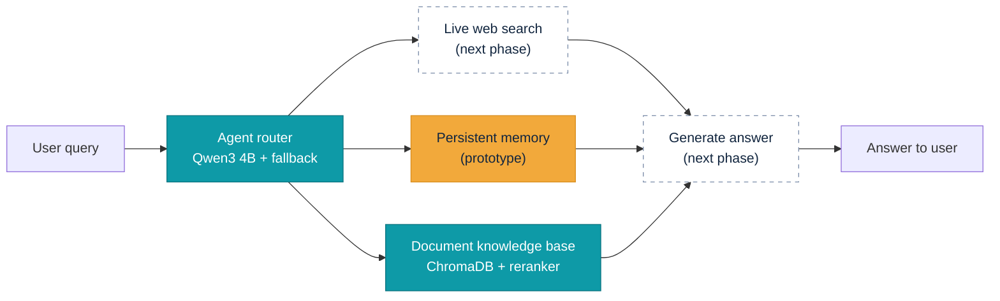

# An-Agentic-RAG-Framework-for-Live-Information-Retrieval-and-Persistent-Memory

An agentic RAG project that first decides **where to look** (the live web, a document store, or direct answer) before the system answers and has a ChromaDB-based memory layer which stores useful user facts between sessions.

## Why this project

Plain language models have three limits:

1. **Static knowledge.** They only know their training data, so they cannot answer about recent events, prices or releases.
2. **No memory between sessions.** Facts and preferences a user shared are lost when the session ends.
3. **Retrieval without judgment.** Standard RAG searches the same source on every query, whether or not that helps.

This project adds a **decision step** in front of retrieval. A router picks one of three routes per query:

| Route | When it is chosen |
|---|---|
| `web_search` | The query needs current or fast-changing information |
| `doc_search` | The query is about the user's own documents or notes |
| `direct_answer` | The model already knows the answer; no retrieval needed |

A small local model is less reliable than a hosted one at following a strict output format, so a large part of the work is **measuring how often the router fails and what to do when it does**.

## Architecture



Teal = built and evaluated, amber = prototype, dashed = next phase.
---

| Experiment | Result |
|---|---|
| Router accuracy (Qwen3 4B), 41 test queries | **85.4%** overall (100% on keyword-aligned queries, 64.7% on keyword-free queries) |
| Fallback router, 6 real router failures | Keyword fallback recovered **0 of 6**; semantic fallback recovered **6 of 6** |
| Retrieval, 21 gold questions | Top-5 hit rate **100%** for both baseline and reranked retrieval (no measurable reranking effect on this small corpus) |
| A measurement pitfall | An early **100% failure rate** was a token-limit artefact, not a weak router.

---

## Repository structure

```text
.
├── README.md
├── requirements.txt
├── .gitignore
├── router_eval.py          # router reliability evaluation (primary + adversarial sets)
├── fallback_ab_test.py     # keyword vs semantic fallback on the recorded failures
├── ingest_docs.py          # chunk, embed and store documents in ChromaDB
├── recall_eval.py          # baseline vs reranked retrieval evaluation
├── memory_layer.py         # persistent memory prototype (ChromaDB) with a CLI
├── gold_queries.json       # 21 gold questions with verified gold chunk IDs
└── demo_docs/              # 7 short technical notes used as the benchmark corpus
    ├── 01_vector_databases.md
    ├── 02_attention_mechanism.md
    ├── 03_gradient_descent.md
    ├── 04_regularization.md
    ├── 05_rest_apis.md
    ├── 06_binary_search_trees.md
    └── 07_cap_theorem.md
---


```

Files created when you run the scripts (all in the working directory):

| File | Created by | Contents |
|---|---|---|
| `router_eval_results.json` | `router_eval.py` | Every query, raw model reply, parse result and route |
| `recall_eval_results.json` | `recall_eval.py` | Per-query rankings for baseline and reranked retrieval |
| `chunk_index.txt` | `ingest_docs.py` | Human-readable list of every chunk ID with a preview |
| `chroma_store/` | `ingest_docs.py`, `memory_layer.py` | The persistent ChromaDB database (do not commit) |

---

### Install

```bash
git clone <your-repo-url>
cd <your-repo-folder>

# optional but recommended
python -m venv .venv
# Windows PowerShell:  .venv\Scripts\Activate.ps1
# macOS / Linux:       source .venv/bin/activate

pip install -r requirements.txt
ollama pull qwen3:4b
```

On Windows the Ollama installer starts the server in the background (check the system tray). On macOS or Linux, run `ollama serve` in a separate terminal if it is not already running. Confirm the exact model name with `ollama list`; if yours differs, change `MODEL_NAME` at the top of `router_eval.py` and `memory_layer.py`.

---

## Usage

Run everything from the repository root, because the scripts read and write files in the working directory.

### 1. Evaluate the router

```bash
python router_eval.py
```

Runs 41 test queries (24 primary + 17 adversarial) through the router and prints three summaries. Example from one run (your counts will vary, see [Reproducibility](#reproducibility)):

```text
PRIMARY      24 queries   0 failures (0.0%)    LLM-only 24/24 (100.0%)   Overall 24/24 (100.0%)
ADVERSARIAL  17 queries   6 failures (35.3%)   LLM-only 11/17 (64.7%)    Overall 11/17 (64.7%)
COMBINED     41 queries   6 failures (14.6%)   LLM-only 35/41 (85.4%)    Overall 35/41 (85.4%)
```

Expect several minutes on a CPU, because the model may reason before it answers. Full raw replies are saved to `router_eval_results.json`.

### 2. Compare the two fallbacks

```bash
python fallback_ab_test.py
```

Takes the router failures recorded in `router_eval_results.json` and gives them to both fallbacks. No Ollama calls are needed.

```text
OLD keyword fallback recovery:   0/6 (0.0%)
NEW semantic fallback recovery:  6/6 (100.0%)
```

### 3. Build the document index

```bash
python ingest_docs.py demo_docs
```

Splits the notes into 200-word chunks with a 40-word overlap (21 chunks), embeds them and stores them in `chroma_store/`. Use your own folder of `.pdf`, `.txt` or `.md` files to index other documents (you would then need your own `gold_queries.json`).

### 4. Evaluate retrieval and reranking

```bash
python recall_eval.py
```

Compares plain top-5 retrieval with "top-20, reranked by a cross-encoder, keep 5" on the 21 gold questions:

```text
Baseline Recall@5:  21/21 (100.0%)
Reranked Recall@5:  21/21 (100.0%)
```

### Agent router (`router_eval.py`)

- One chat call to Ollama (`qwen3:4b`, streaming off) with a system prompt that lists the three routes and demands a bare JSON reply: `{"route": "<name>"}`.
- The reply is cleaned (`<think>` blocks and code fences removed), parsed, and accepted only if the route name is one of the three allowed values.
- A **failure** is any of: invalid JSON, a missing or unknown route, a request timeout, or a reply cut off by the token limit.
- Settings: `think=false` and `/no_think` requested, `num_predict=400`, timeout 180 s.
- Constrained JSON mode (Ollama's `format` option) is **deliberately not used**. It would force valid JSON and hide exactly the failures this project measures.

### Fallback routers

| | Keyword fallback (v1) | Semantic fallback (v2) |
|---|---|---|
| Idea | Look for trigger words (`latest`, `current`, `my notes`, ...) | Compare the meaning of the query with a few example phrases per route |
| Weaknesses | Substring matching (`now` also fires inside `know`); any query without a keyword goes to `direct_answer` | Depends on the hand-written example phrases |
| Training | None | None (7 web, 6 document and 5 direct example phrases; the closest example decides) |

The example phrases and keyword lists are listed in the source files.

### Document retrieval (`ingest_docs.py`, `recall_eval.py`)

- 7 short technical notes, split into 200-word windows with 40-word overlap, give 21 chunks. Files are read in sorted order, so chunk IDs (`chunk_0000` ... `chunk_0020`) are deterministic.
- Chunks are embedded with `all-MiniLM-L6-v2` and stored in a persistent ChromaDB collection (`docs`).
- **Baseline:** the 5 chunks closest to the query. **Reranked:** the 20 closest chunks, reordered by `cross-encoder/ms-marco-MiniLM-L-6-v2`, keeping 5.
- `gold_queries.json` has one question per chunk. Each gold label is the set of chunks that contain a distinctive answer phrase, found by script rather than typed by hand. One question (early stopping) has two gold chunks because the answer sits in the overlap of two chunks.

### Memory layer (`memory_layer.py`, prototype)

- A separate ChromaDB collection (`memory`, cosine distance) stores short facts with type, source and UTC timestamp.
- **Write:** a local model extracts durable user facts from a message; a fact that is nearly identical to an existing memory is skipped.
- **Read:** the few most relevant memories above a relevance threshold are added to the prompt.
- Thresholds are untuned starting values. The mechanics (storage, persistence across separate processes, duplicate skipping) were checked with an offline stand-in embedder.

---

## Evaluation method

### Two router test sets, on purpose

| Set | Queries | Purpose |
|---|---|---|
| **Primary** | 24 (8 direct, 8 web, 8 document) | Written alongside the keyword fallback, so many queries contain its trigger words. A fair test of the model, a poor test of the fallback. |
| **Adversarial** | 17 (3 direct, 8 web, 6 document) | Written to avoid every keyword the fallback uses, so it can show whether a fallback generalises. |

Both lists are at the top of `router_eval.py`.

### A measurement pitfall worth knowing about

| Run | Configuration | Outcome |
|---|---|---|
| 1 | 60 s timeout, request errors not caught | Query 5 timed out and the script crashed |
| 2 | 150-token limit, errors caught | **All 24 calls counted as failures.** Invalid. |
| 3 | 400-token limit, primary set only | 2 of 24 failures, both recovered |
| 4 | Adversarial set added, final script | Primary 0 failures; adversarial 6 of 17 failures |

Run 2 looked like a result and was a bug: Qwen3 kept reasoning even with `think=false`, and the 150-token budget ran out before the JSON appeared. Reading the raw replies in the log exposed it. **Lesson: log raw outputs and read them before trusting a metric.**

---

## Results in detail

### Router (run 4)

| Test set | Queries | Failures | LLM-only accuracy | Overall accuracy |
|---|---|---|---|---|
| Primary | 24 | 0 (0.0%) | 100.0% | 100.0% |
| Adversarial | 17 | 6 (35.3%) | 64.7% | 64.7% |
| Combined | 41 | 6 (14.6%) | 85.4% | 85.4% |

LLM-only and overall accuracy are identical because the keyword fallback recovered none of the six failures.

### Fallback comparison (the same six failures)

| Failed query | Expected | Keyword | Semantic |
|---|---|---|---|
| Has SpaceX launched Starship again? | web_search | wrong | correct |
| Did India win their series decider against Australia? | web_search | wrong | correct |
| Which version of PyTorch just came out? | web_search | wrong | correct |
| Which repositories are trending on GitHub? | web_search | wrong | correct |
| What have I covered so far in my machine learning coursework? | doc_search | wrong | correct |
| What does the report say about evaluation methodology? | doc_search | wrong | correct |

## Roadmap

- [ ] Evaluate the memory layer: facts stored in one process recalled in a fresh process, with hit rates reported
- [ ] Add the live web search tool (Tavily, DuckDuckGo fallback) with cited sources
- [ ] Larger reranking study: hundreds of similar-topic chunks so reranking has room to help
- [ ] Stronger router tests: more queries, repeated seeded runs, per-query failure analysis, other model sizes
- [ ] Orchestrate with LangGraph: route, tools, answer and memory write-back as one workflow with logged decisions
- [ ] End-to-end evaluation: answers scored for correctness and grounding, with and without each component

---

## Reproducibility

- **Router results:** the model is not seeded, so failure counts will vary from run to run. Report the spread if you repeat the evaluation.
- **Retrieval results:** no sampling is involved; with the same corpus, chunking settings and model versions they should reproduce exactly.
- The JSON logs contain every raw reply and every ranking behind the tables above.
- Software used: Python 3.13 on Windows, Ollama with `qwen3:4b`, `sentence-transformers`, `chromadb`, `requests`, `pypdf`.

---
